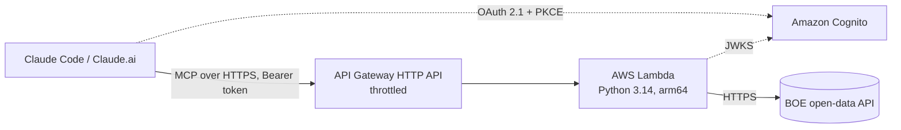

# boe-mcp

A remote [Model Context Protocol](https://modelcontextprotocol.io) (MCP) server that lets AI
agents read Spain's official gazette, the Boletín Oficial del Estado (BOE): what was published on
a day, which rules are in force, what changed them and what an article says today.

It is written in Python with the official MCP SDK, protected with OAuth 2.1 (Amazon Cognito as
authorization server, tokens bound to this server's URL), and deployed on AWS Lambda behind API
Gateway with Terraform.

> [!NOTE]
> The texts it returns come from the BOE's open-data API. Consolidated texts are informative:
> only the signed PDF of the BOE is official. This project is not affiliated with the BOE.

## Tools

| Tool | What it does |
| --- | --- |
| `get_daily_summary` | What the BOE published on a day (today by default), by section, with links to the signed PDFs |
| `search_legislation` | Find a rule in the consolidated collection by title words, full-text words or official number |
| `get_legislation` | Whether a rule is in force today, its outline and the later rules that changed it |
| `read_legislation_block` | The latest wording of one article or other block, whether it is in force today, any wording approved for later, and its history |

All four are read-only. A typical question, «¿Ha cambiado el artículo 23 de la ley de protección
de datos?», makes the model search for `3/2018`, read the outline of `BOE-A-2018-16673`, and
read block `a2-5`, which Ley 10/2025 rewrote with effect from 28 December 2025.

## How it works



- **Transport:** Streamable HTTP, stateless, one JSON answer per request
  ([ADR 0001](docs/adr/0001-stateless-streamable-http.md)). It speaks MCP 2026-07-28 and the
  older handshake revisions.
- **Authorization:** the server is an OAuth 2.1 resource server. It publishes Protected Resource
  Metadata (RFC 9728) and accepts only Cognito access tokens whose audience is its own URL
  (RFC 8707), from a known client, with the `read` scope
  ([ADR 0002](docs/adr/0002-oauth-with-cognito.md)).
- **Hosting:** API Gateway in front of Lambda, with the Lambda Web Adapter running the
  unchanged ASGI app ([ADR 0003](docs/adr/0003-api-gateway-and-lambda.md)); infrastructure in
  Terraform ([ADR 0004](docs/adr/0004-terraform.md)).

A step-by-step explanation in Spanish, from what MCP is to how the token is checked, is in
[docs/guia.md](docs/guia.md).

## Use it

**Hosted, with Claude:** see [docs/deploy.md](docs/deploy.md). Users are created by an
administrator; there is no public sign-up.

**Locally, over stdio**, no login needed:

```sh
uv tool install git+https://github.com/sergiooriola/boe-mcp
claude mcp add boe -- boe-mcp stdio
```

## Develop

Requires [uv](https://docs.astral.sh/uv/) and, for the infrastructure,
[Terraform](https://developer.hashicorp.com/terraform) 1.11 or later.

```sh
uv sync
make check   # Ruff format and lint, strict mypy, pytest with 90 % minimum coverage
make build   # Lambda package for arm64 in build/lambda.zip
```

Tests run against responses recorded from the live BOE API and never touch the network. The
OAuth tests sign their own tokens with a throwaway RSA key. A few tests ask the live API about
facts that do not change, to notice when it changes under the recordings. They are skipped by
default, run with `uv run pytest -m live --no-cov`, and a workflow runs them every Monday.

## Security

- Only RS256 tokens signed by the user pool, issued for this server's URL, to a registered app
  client, with the `read` scope. Users sign in with a password and an authenticator app.
- Model-written arguments are untrusted: identifiers are validated before they reach a URL,
  search input cannot add operators to the BOE's query language, and XML is parsed with
  `defusedxml`.
- Requests to any other host name are refused (DNS rebinding protection); API Gateway caps
  traffic at 5 requests per second.
- The function's only AWS permission is to write its own logs. The logs never contain tool
  arguments or answers. Access lines keep the caller's IP address, and everything is deleted
  after 30 days.

Report vulnerabilities through [GitHub's private reporting](https://github.com/sergiooriola/boe-mcp/security/advisories/new).

## Cost

At a few hundred requests a month, under 0.05 USD a month in `eu-south-2`: Lambda and Cognito
stay within their always-free allowances, and API Gateway costs 1.11 USD per million requests.
A 2 USD monthly budget emails at half of it.

## Data

"Basado en datos de la Agencia Estatal Boletín Oficial del Estado"
([reuse conditions](https://www.boe.es/informacion/aviso_legal/index.php#reutilizacion)).

## License

[MIT](LICENSE).
