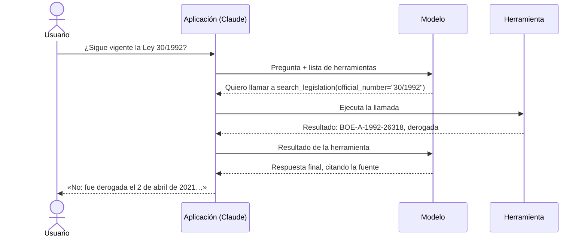
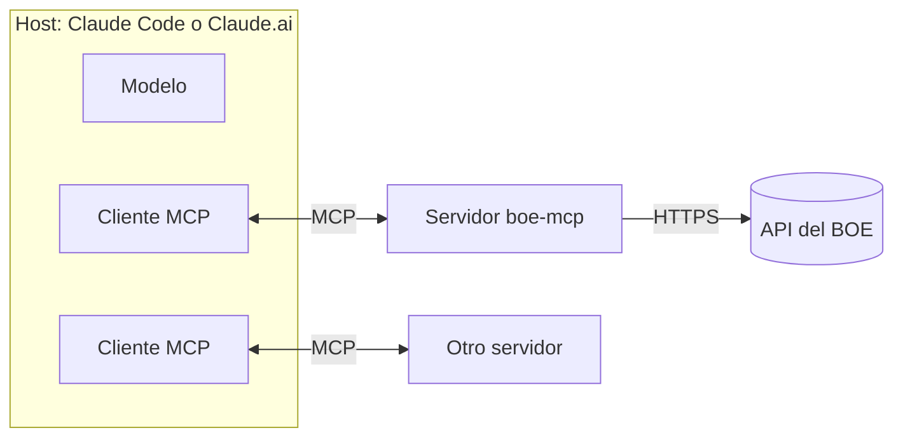
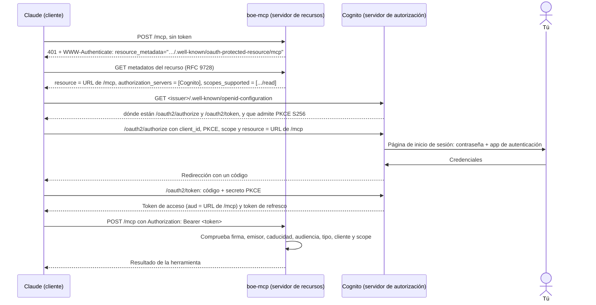
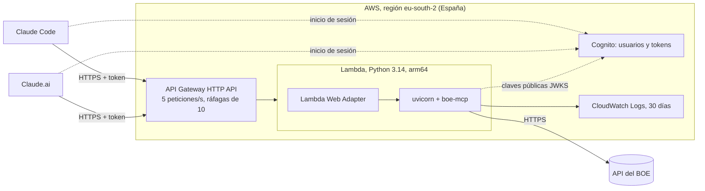

# Guía técnica de boe-mcp

Esta guía explica, en orden y desde los fundamentos, qué hace este servidor y por qué está
hecho así. Cada capítulo empieza diciendo qué problema resuelve y en qué capítulos se apoya, y
cada concepto se define antes de usarlo. Los ejemplos salen del propio proyecto.

Las decisiones técnicas importantes tienen su registro, con las alternativas descartadas, en
[`docs/adr/`](adr/), en inglés como el resto del repositorio.

## Índice

1. [Qué hace, con un ejemplo](#1-qué-hace-con-un-ejemplo)
2. [El problema: el modelo no puede leer el BOE de hoy](#2-el-problema-el-modelo-no-puede-leer-el-boe-de-hoy)
3. [Herramientas y tool calling](#3-herramientas-y-tool-calling)
4. [MCP: un enchufe común para las herramientas](#4-mcp-un-enchufe-común-para-las-herramientas)
5. [Las cuatro herramientas y cómo se diseñan](#5-las-cuatro-herramientas-y-cómo-se-diseñan)
6. [La fuente: la API de datos abiertos del BOE](#6-la-fuente-la-api-de-datos-abiertos-del-boe)
7. [El transporte: cómo viajan los mensajes](#7-el-transporte-cómo-viajan-los-mensajes)
8. [La autenticación: OAuth 2.1 desde cero](#8-la-autenticación-oauth-21-desde-cero)
9. [El despliegue en AWS](#9-el-despliegue-en-aws)
10. [Calidad: cómo sé que funciona](#10-calidad-cómo-sé-que-funciona)
11. [Seguridad: amenazas y defensas](#11-seguridad-amenazas-y-defensas)
12. [Límites y siguientes pasos](#12-límites-y-siguientes-pasos)
13. [Preguntas de una revisión técnica](#13-preguntas-de-una-revisión-técnica)
14. [Glosario](#14-glosario)

---

## 1. Qué hace, con un ejemplo

**Problema que resuelve el capítulo:** saber de qué va el proyecto antes de entrar en cómo
funciona.

boe-mcp es un servidor que deja a un asistente de IA, como Claude, consultar el Boletín Oficial
del Estado: qué se publicó un día, buscar una norma, saber si sigue vigente, ver qué normas la
han cambiado y leer el texto actual de un artículo.

Un ejemplo de uso real. Le preguntas a Claude:

> ¿Ha cambiado algo en el artículo 23 de la ley de protección de datos?

Claude no responde de memoria. Usa tres de las cuatro herramientas del servidor, una detrás de
otra:

1. `search_legislation` con `official_number: "3/2018"` encuentra la Ley Orgánica 3/2018 y su
   identificador, `BOE-A-2018-16673`. Hay otras normas con ese número, como una ley gallega y
   otra canaria, así que el modelo elige por el título.
2. `get_legislation` con `outline_contains: "23"` devuelve que está en vigor y las normas que la
   han modificado. La más reciente es `BOE-A-2025-26698`, la Ley 10/2025, que «modifica el art.
   23». De los 169 bloques de su índice (artículos, disposiciones…), devuelve solo el que se
   titula «Artículo 23»: el bloque `a2-5`.
3. `read_legislation_block` devuelve el texto de ese artículo, confirma que está en vigor
   (`in_force: true`) y da su historia: la redacción original de 2018 y la actual, en vigor
   desde el 28 de diciembre de 2025.

Claude contesta con el texto, el identificador y el enlace al BOE, y recuerda que el texto
consolidado es informativo: solo el PDF firmado del BOE es oficial.

---

## 2. El problema: el modelo no puede leer el BOE de hoy

**Problema:** por qué un asistente de IA necesita un servidor como este.
**Se apoya en:** nada; es el punto de partida.

Un **modelo de lenguaje** (LLM, *large language model*) es un programa que, dado un texto,
genera el texto que más probablemente lo continúa. Ha aprendido de una enorme cantidad de
texto hasta una fecha, su **fecha de corte**. De ahí salen tres limitaciones:

- **No sabe lo que pasó después de su fecha de corte.** El BOE publica unas 200 entradas cada
  día, salvo los domingos.
- **No sabe qué día es hoy**, salvo que se lo digan.
- **Puede inventar**: si le preguntas por un artículo que no recuerda bien, puede generar una
  redacción plausible pero falsa. En materia legal, eso es grave.

La solución es dejar que el modelo **consulte** la fuente en lugar de recordarla, y que cite lo
que ha leído. Para eso necesita herramientas.

---

## 3. Herramientas y tool calling

**Problema:** cómo un modelo, que solo genera texto, puede consultar el BOE.
**Se apoya en:** el capítulo 2.

Una **herramienta** (*tool*) es una función que la aplicación pone a disposición del modelo.
Tiene tres cosas:

- un **nombre**, por ejemplo `get_legislation`;
- una **descripción** en lenguaje natural, que el modelo lee para saber cuándo usarla;
- un **esquema de entrada**: qué parámetros acepta y de qué tipo. Se escribe en **JSON Schema**,
  un estándar para describir la forma de un documento JSON. Por ejemplo, «`law_id` es un texto
  de 40 caracteres como mucho».

**Tool calling** (llamada a herramientas, también *function calling*) es el mecanismo por el
que el modelo pide usar una herramienta. El modelo **no ejecuta nada**: genera una petición
estructurada, la aplicación la ejecuta y le devuelve el resultado, y el modelo sigue
escribiendo con esa información.



Lo que el modelo genera al pedir la llamada es, en esencia, esto:

```json
{ "name": "search_legislation", "arguments": { "official_number": "30/1992" } }
```

Eso tiene una consecuencia de seguridad que aparece en toda la guía: **los argumentos de una
herramienta los escribe el modelo**, y el modelo puede equivocarse o haber sido manipulado por
un texto que leyó. El servidor trata cada argumento como entrada no fiable.

---

## 4. MCP: un enchufe común para las herramientas

**Problema:** sin un estándar, cada aplicación de IA define las herramientas a su manera, y
conectar M aplicaciones con N sistemas exige M × N integraciones.
**Se apoya en:** el capítulo 3.

El **Model Context Protocol** (MCP) es un protocolo abierto que estandariza cómo una aplicación
de IA descubre y usa herramientas y datos externos. Es a las herramientas de IA lo que un
enchufe estándar a los aparatos: el servidor se escribe una vez y lo usa cualquier aplicación
compatible (Claude Code, Claude.ai y muchas más).

### Los tres papeles

- **Host:** la aplicación con la que habla la persona: Claude Code o Claude.ai.
- **Cliente:** la parte del host que mantiene la conexión con *un* servidor. Un host con tres
  servidores tiene tres clientes.
- **Servidor:** el programa que ofrece las herramientas. **boe-mcp es un servidor.**



### Los mensajes

MCP usa **JSON-RPC 2.0**: un formato en el que cada mensaje es un JSON con un método
(`method`), sus parámetros (`params`) y un identificador (`id`) para emparejar la respuesta con
la petición. Los dos métodos que importan aquí:

- `tools/list`: el cliente pregunta qué herramientas hay. El servidor responde con el nombre, la
  descripción, el esquema de entrada y el de salida de cada una.
- `tools/call`: el cliente pide ejecutar una herramienta con unos argumentos.

Una llamada real a este servidor, simplificada:

```json
{ "jsonrpc": "2.0", "id": 7, "method": "tools/call",
  "params": { "name": "get_legislation", "arguments": { "law_id": "BOE-A-2018-16673" } } }
```

### Herramientas, recursos y prompts

MCP define tres cosas que un servidor puede ofrecer:

- **Herramientas** (*tools*): funciones que **el modelo** decide llamar.
- **Recursos** (*resources*): datos que **la aplicación** decide adjuntar, como un archivo.
- **Prompts**: plantillas de mensajes que **la persona** elige.

Este servidor solo ofrece herramientas, porque todo lo que hace depende de parámetros que el
modelo elige según la pregunta: una fecha, unas palabras, un identificador. Recursos o prompts
no añadirían nada hoy.

### El SDK

Un **SDK** (*software development kit*) es una biblioteca que implementa el protocolo para que
no haya que escribirlo a mano. El proyecto usa el **SDK oficial de Python, `mcp` 2.3.0**, con
su clase `MCPServer`. Cada herramienta es una función de Python con un decorador. Esta es la
firma de `get_legislation`, sin las descripciones de cada parámetro:

```python
@server.tool(title="Rule status, outline and changes", annotations=READ_ONLY)
async def get_legislation(
    ctx: ToolContext,
    law_id: Annotated[str, Field(max_length=40)],
    outline_contains: Annotated[str | None, Field(max_length=200)] = None,
    outline_offset: Annotated[int, Field(ge=0)] = 0,
) -> Legislation:
    """Describe one consolidated rule: its status today, its outline and its later changes."""
```

El SDK lee de esa firma el nombre, la descripción (el docstring), el esquema de entrada (los
tipos de los parámetros) y el de salida (el tipo de retorno, un modelo de Pydantic).

---

## 5. Las cuatro herramientas y cómo se diseñan

**Problema:** qué herramientas ofrecer y cómo escribirlas para que un modelo las use bien.
**Se apoya en:** los capítulos 3 y 4.

| Herramienta | Qué hace | Peticiones al BOE |
| --- | --- | --- |
| `get_daily_summary` | Lo publicado un día (hoy por defecto), filtrable por sección y por palabras del título | 1 |
| `search_legislation` | Busca normas consolidadas por título, texto o número oficial | 1 |
| `get_legislation` | Estado de una norma hoy, su índice (por páginas y filtrable por palabras de los títulos) y las normas que la han cambiado | 3, en paralelo |
| `read_legislation_block` | Última redacción de un bloque (un artículo, el preámbulo, un anexo), si está en vigor, la aprobada para más adelante y su historia | 2, en paralelo |

El código está en [`src/boe_mcp/server.py`](../src/boe_mcp/server.py). Estos son los principios
de diseño, cada uno con su ejemplo.

**Pocas herramientas que cubren una tarea entera.** Un modelo elige peor entre veinte
herramientas pequeñas que entre cuatro claras. `get_legislation` hace tres peticiones al BOE
(metadatos, análisis e índice) y devuelve todo junto, porque el modelo casi siempre necesita
las tres cosas a la vez.

**La descripción es el manual que lee el modelo.** Dice qué hace la herramienta, cuándo usarla y
cómo encadenarla. Además, el servidor envía unas **instrucciones** generales (`INSTRUCTIONS`)
con el recorrido típico: buscar la norma, después buscar el artículo en su índice con
`outline_contains` y después leer el bloque.

**El esquema de entrada pone límites.** Los tipos de Python se convierten en JSON Schema:

- `limit` va de 1 a 100;
- `sections` solo admite los códigos reales del BOE (`"1"`, `"2A"`, `"T"`…), que el modelo ve
  como una lista cerrada (`enum`);
- cada texto tiene una longitud máxima.

Un argumento fuera de esos límites ni siquiera llega al código.

**Salida estructurada.** Cada herramienta devuelve un modelo de **Pydantic** (una biblioteca que
valida datos a partir de tipos de Python). El SDK publica su forma como esquema de salida
(`outputSchema`) y envía el resultado como JSON (`structuredContent`), además de en texto. Las
descripciones de los campos también las lee el modelo; por ejemplo, la de `detail` en un
cambio dice «show it, don't parse it», porque ese texto lo escribe a mano el BOE.

**Anotaciones.** Las cuatro herramientas se marcan como de solo lectura (`readOnlyHint`) y
como herramientas que consultan un sistema externo (`openWorldHint`). Son **pistas** para el
host, por ejemplo para no pedir confirmación antes de ejecutarlas. La especificación dice que
el host no debe fiarse de ellas si el servidor no es de confianza.

**Respuestas acotadas.** Cada respuesta ocupa espacio en el contexto del modelo, que es
limitado y cuesta dinero.

- `get_daily_summary` devuelve 30 entradas por defecto y siempre el recuento de cada sección,
  para que el modelo sepa qué más hay.
- La paginación usa `offset` y `next_offset`. Para saber si hay otra página, la búsqueda pide al
  BOE un resultado más de los que devuelve.
- `get_legislation` devuelve como mucho los 30 cambios más recientes, junto con el total.
- `get_legislation` devuelve el índice en páginas de 200 bloques, con el total de bloques que
  pasan el filtro (`outline_total`) y el punto de la página siguiente (`outline_next_offset`),
  que se pasa como `outline_offset` con el mismo filtro. El índice del
  Código Civil tiene 2.444 bloques, unos 250.000 caracteres, y Claude Code saca a un archivo
  cualquier resultado de más de 50.000. Con páginas de 200, la respuesta más grande medida, la
  de la Ley Orgánica del Poder Judicial, ronda los 33.000.
- `outline_contains` deja solo los bloques cuyo título tiene todas las palabras dadas, como
  palabras enteras y sin distinguir mayúsculas ni tildes: `23` encuentra «Artículo 23», pero no
  «Artículo 123» ni «Artículo 230». Los títulos no numeran los apartados, así que para el
  artículo 23.1 hay que dar `23`, y la descripción del parámetro lo dice.
- `read_legislation_block` corta los textos de más de 20.000 caracteres por el final de un
  párrafo y lo indica con `truncated: true`.

**Errores que dicen qué hacer.** En MCP hay dos clases de error:

- **Errores de protocolo**, como una herramienta que no existe o una petición mal formada. Los
  gestiona el SDK.
- **Errores de ejecución**, que el modelo debe leer para corregirse. Se devuelven como un
  resultado con `isError: true` y un mensaje útil:
  - una fecha en domingo: «There is no BOE for 2026-10-11: the BOE is not published on
    Sundays…»;
  - un identificador mal formado: «BOE identifiers look like BOE-A-2018-16673»;
  - un bloque que no existe: «Call get_legislation for the outline, with outline_contains set
    to the article number, and use one of its block_id values».

**El modelo no sabe qué día es.** Por eso `get_daily_summary` usa por defecto la fecha de hoy
en la hora de Madrid, que es la del calendario del BOE.

---

## 6. La fuente: la API de datos abiertos del BOE

**Problema:** leer el BOE de forma fiable, respetuosa con el BOE y segura.
**Se apoya en:** el capítulo 5.

Una **API** (*application programming interface*) es una forma de que un programa pida datos a
otro. El BOE ofrece dos, gratuitas y sin clave, en `https://www.boe.es/datosabiertos/api/`:

- **Sumario del BOE:** `boe/sumario/{AAAAMMDD}` devuelve todo lo publicado un día.
- **Legislación consolidada:** una búsqueda, y por cada norma sus metadatos, su análisis
  (materias y referencias a otras normas), el índice de su texto y cada bloque del texto.

Un **texto consolidado** es el texto de una norma con todas sus modificaciones ya
incorporadas: lo que dice hoy, no lo que decía cuando se publicó.

Las conozco a fondo por el estudio de viabilidad del radar normativo, que leyó 60 días de
sumarios (11.718 publicaciones) y comprobó diez relaciones de modificación y derogación. De ahí
salen varias decisiones:

- **XML en lugar de JSON.** El JSON del BOE convierte un nodo con un solo hijo en un objeto y
  uno con varios en una lista, así que cambia de forma según los datos. El XML no.
- **El estado de una norma se calcula con las fechas, no solo con las marcas.**
  - El BOE puede registrar una derogación futura sin marcar todavía la norma como derogada. El
    Real Decreto 1414/2006 tiene `estatus_derogacion` N y `fecha_derogacion` 2027-01-02.
    `status_on` devuelve `repeal_scheduled` hasta esa fecha y `repealed` desde ella.
  - Una norma publicada que aún no ha entrado en vigor es `not_yet_in_force`. La LO 3/2018 se
    publicó el 6 de diciembre de 2018 y entró en vigor el 7.
- **La redacción de un artículo se elige por su fecha de entrada en vigor.** Una modificación
  puede publicarse hoy y aplicarse dentro de meses. `read_legislation_block` devuelve la última
  redacción que ya ha entrado en vigor y, aparte, la aprobada para más adelante.
- **Un artículo de una norma derogada conserva su última redacción, pero ya no está en vigor.**
  Por eso `read_legislation_block` consulta también los metadatos de la norma y solo marca
  `in_force: true` si la norma está en vigor y esa redacción ya se aplica.
- **Las relaciones se leen por su código y su identificador,** nunca por el texto libre, que el
  BOE escribe a mano.

El uso con normas antiguas y grandes, como el Código Civil, enseñó tres cosas más (capítulo 10):

- **Un bloque puede no tener título.** El BOE deja vacío el título del preámbulo y de la firma
  en muchas normas. La LO 3/2018, que era la del índice grabado en las pruebas, los titula
  «[preambulo]» y «[firma]», así que el índice de casi todas las demás fallaba. Ahora un
  bloque sin título tiene un título vacío, y el esquema de salida avisa al modelo de que puede
  estarlo.
- **Un artículo también se deroga solo, y el BOE lo marca de dos formas distintas.**
  - Con un **aviso**: una versión nueva que solo tiene el título del bloque y «(Derogado)»,
    «(Suprimido)», «(Anulado)» o «(Sin contenido)». Sus fechas dicen cuándo surte efecto la
    derogación. El artículo 387 de la Ley de Enjuiciamiento Criminal solo tiene esta marca.
  - Con `fecha_caducidad`, la fecha desde la que el BOE deja de mostrar el bloque, que suele
    ser la de publicación de la norma que lo deroga. Los artículos marítimos del Código de
    Comercio, derogados en 2014, solo tienen esta marca y conservan su texto completo.

  `read_legislation_block` marca `in_force: false` en los dos casos y lo explica con
  `repealed` en cada versión y `lapsed_on` en el bloque. La fecha de caducidad no cuenta
  mientras el aviso de derogación aún no haya entrado en vigor: el artículo 301 del Código
  Civil caducó el 3 de junio de 2021, pero su derogación surtió efecto el 3 de septiembre.
  Antes del arreglo, 1.033 de 9.655 bloques de 12 normas salían como vigentes sin estarlo.
- **La documentación del BOE no siempre coincide con su API.** Su guía dice que un rango de
  fechas puede tener un solo extremo, pero la API ignora un rango así: «Código Civil» publicado
  hasta 1890 devolvía normas de 2003 a 2024. Por eso la búsqueda envía siempre los dos extremos
  y rellena el que falta con la primera o la última fecha posible. Una prueba contra el BOE
  real lo vigila.

**Condiciones de reutilización.** El BOE permite reutilizar sus datos con condiciones:

- citar la fuente con un enlace;
- decir que el texto consolidado es informativo y que solo el PDF firmado es oficial;
- no aparentar carácter oficial.

Cada respuesta del servidor lleva ese aviso en el campo `notice`. Además, cada petición se
identifica en su *User-Agent* con el nombre del proyecto y su repositorio, y el servidor no usa
los enlaces XML de cada entrada del sumario, que el `robots.txt` del BOE prohíbe.

### La entrada del modelo es entrada no fiable

Tres defensas, en [`src/boe_mcp/boe_client.py`](../src/boe_mcp/boe_client.py):

1. **Identificadores validados antes de construir la URL.** `law_id` va dentro de la ruta de la
   URL. Sin validarlo, un argumento como `../../robots.txt` haría que el servidor pidiera otra
   ruta del BOE. Una expresión regular solo admite identificadores con la forma
   `BOE-A-2018-16673`. Para los bloques admite letras, cifras, guiones, puntos y paréntesis de
   cierre, hasta 80 caracteres, que son los únicos que aparecen en los índices del BOE: `a2-5`,
   `art.1863bis` o `a846bisa)`. Un bloque necesita además una letra o una cifra, porque `.` o
   `..` solos subirían en la ruta. Lo demás se rechaza sin hacer ninguna petición. Hay pruebas
   para eso.
2. **Búsqueda sin inyección.** La búsqueda del BOE tiene su propio lenguaje, con pares
   `campo:valor` unidos por `and`, `or` y `not`. Si el servidor pegara tal cual lo que escribe
   el modelo, este podría alterar la consulta. Por eso la entrada se corta en palabras, se
   quitan `and`, `or` y `not`, y cada palabra se convierte en su propia condición:
   `ley) or (rango@codigo:1300` acaba siendo `titulo:ley and titulo:rango and titulo:codigo and
   titulo:1300`.
3. **XML analizado con `defusedxml`,** que rechaza las construcciones de XML con las que se
   ataca a quien lo lee, como las entidades que se expanden hasta agotar la memoria.

**Privacidad en los registros.** El servidor registra cada llamada con el nombre de la
herramienta, el resultado y la duración, pero nunca los argumentos ni la respuesta. Los
argumentos pueden contener nombres de personas: la sección II.A del BOE publica nombramientos.
Por la misma razón, el cliente del BOE impide que la biblioteca HTTP registre las URL, que
llevan las palabras de búsqueda, y una prueba comprueba que un nombre buscado nunca llega a
los registros.

---

## 7. El transporte: cómo viajan los mensajes

**Problema:** cómo llegan los mensajes JSON-RPC del cliente al servidor, en local y en la
nube.
**Se apoya en:** el capítulo 4.

Un **transporte** es el canal por el que viajan los mensajes. MCP define dos:

- **stdio:** el host arranca el servidor como un proceso en el mismo ordenador y se comunica
  por la entrada y la salida estándar. Sirve para uso local: `boe-mcp stdio`.
- **Streamable HTTP:** el servidor es un servicio web con un único punto de entrada, en este
  caso `POST /mcp`. Es el único transporte para un servidor remoto, y Claude.ai solo admite
  servidores remotos.

### La versión de la especificación

La especificación de MCP se publica por versiones con fecha. La vigente es la del
**28 de julio de 2026**, y trae un cambio de fondo: **ya no hay sesiones**.

- Antes, el cliente empezaba con un saludo (`initialize`) y el servidor le asignaba una sesión
  (`Mcp-Session-Id`) que recordaba entre peticiones.
- Ahora cada petición es autosuficiente: lleva en `_meta` su versión de protocolo y las
  capacidades del cliente, y debe llevar las cabeceras `MCP-Protocol-Version`, `Mcp-Method` y
  `Mcp-Name`.

Los clientes que hablan versiones anteriores siguen enviando `initialize`. El SDK atiende a
los dos tipos de cliente en el mismo punto de entrada, y las pruebas comprueban ambos.

### Por qué sin estado y con JSON

El servidor corre en AWS Lambda (capítulo 9), donde cada petición puede caer en una copia
distinta del programa y ninguna copia dura mucho. Si el servidor guardara sesiones en memoria,
la segunda petición podría llegar a una copia que no la conoce. Así que:

- `stateless_http=True`: tampoco guarda sesión para los clientes antiguos;
- `json_response=True`: contesta cada petición con un JSON, sin abrir un flujo de eventos
  (*Server-Sent Events*), porque las herramientas responden en menos de un segundo y no hay
  nada que ir enviando por partes.

### Seguridad del transporte

- **HTTPS** en todo el camino público. El certificado lo pone API Gateway.
- **Comprobación del `Host` y del `Origin`.** El SDK solo acepta peticiones dirigidas al nombre
  público del servidor (contesta 421 a las demás) y, si traen la cabecera `Origin`, solo desde el
  propio origen del servidor (contesta 403 a las demás). Así se evita el **DNS rebinding**: un
  ataque en el que una web maliciosa hace que el navegador de la víctima envíe peticiones a un
  servidor que se creía inaccesible desde fuera.
- **Sin flujo por `GET`.** Los clientes antiguos pueden abrir con `GET` un flujo para recibir
  mensajes del servidor. Un servidor sin estado no tiene nada que enviarles, y en Lambda ese
  flujo abierto mantendría la invocación en marcha, y facturando, hasta agotar su tiempo. El
  servidor contesta `GET` con 405, que según la especificación significa «aquí no hay flujo».
- **Sin suscripciones a cambios.** La versión de 2026 sustituye ese `GET` por una petición,
  `subscriptions/listen`. Su respuesta es un flujo que queda abierto para avisar de cambios,
  por ejemplo si cambia la lista de herramientas. Aquí la lista no cambia nunca, así que el
  servidor no ofrece esa petición (`subscriptions=False`) y tampoco anuncia que avisa de
  cambios (`listChanged`). Por eso los clientes no la abren. El capítulo 9 cuenta cómo se
  descubrió que hacía falta.
- **Una sola forma de escribir la URL.** La URL del servidor se compara carácter a carácter con
  la audiencia de cada token, así que la configuración solo admite una ruta de punto de entrada
  sin barra final (`…/mcp`). Con `https://host/` frente a `https://host`, todos los tokens
  fallarían.

---

## 8. La autenticación: OAuth 2.1 desde cero

**Problema:** que solo puedan usar el servidor las personas y las aplicaciones autorizadas,
de la forma que pide la especificación de MCP.
**Se apoya en:** los capítulos 4 y 7.

### Autenticar y autorizar

- **Autenticar** es comprobar quién eres: una contraseña y un código de una app.
- **Autorizar** es decidir qué puedes hacer: leer el BOE a través de este servidor.

Los datos del BOE son públicos, pero el servidor no lo es: cada petición cuesta dinero y carga
al BOE. Además, el proyecto muestra cómo se protege el acceso de un agente a una API de
empresa, que es donde esto importa de verdad.

### Por qué no basta una clave fija

Una **API key** (una clave fija en una cabecera) es lo más simple, pero:

- no caduca;
- no distingue personas;
- si se filtra hay que cambiarla para todos;
- y no es lo que pide la especificación de MCP, así que Claude.ai no sabría obtenerla.

### OAuth: los cuatro papeles

**OAuth 2.1** es el estándar para que una aplicación obtenga permiso limitado para usar un
servicio en nombre de una persona, sin conocer su contraseña. Tiene cuatro papeles:

| Papel | En este proyecto |
| --- | --- |
| Propietario del recurso: quien da permiso | Tú, con tu usuario |
| Cliente: la aplicación que pide acceso | Claude Code o Claude.ai |
| Servidor de autorización: quien comprueba a la persona y emite permisos | Amazon Cognito |
| Servidor de recursos: quien guarda lo protegido y comprueba los permisos | boe-mcp |

El permiso es un **token de acceso**: una credencial temporal que el cliente envía en cada
petición, en la cabecera `Authorization: Bearer <token>`. Así, el servidor MCP nunca ve una
contraseña.

### El token: un JWT

Cognito emite los tokens como **JWT** (*JSON Web Token*): un JSON firmado digitalmente, en tres
partes separadas por puntos (cabecera, contenido y firma). Cualquiera puede leer el contenido,
pero solo Cognito puede firmarlo. Sus campos se llaman **claims**. Uno de este servidor
contiene, simplificado:

```json
{
  "iss": "https://cognito-idp.eu-south-2.amazonaws.com/eu-south-2_XXXX",
  "aud": "https://xxxx.execute-api.eu-south-2.amazonaws.com/mcp",
  "sub": "identificador de tu usuario",
  "client_id": "identificador de Claude Code en Cognito",
  "token_use": "access",
  "scope": "https://xxxx.execute-api.eu-south-2.amazonaws.com/mcp/read",
  "exp": 1763400000
}
```

- `iss`: quién lo emitió (el *issuer*).
- `aud`: para quién se emitió (la *audiencia*).
- `exp`: cuándo caduca, a la hora de emitirse.
- `scope`: qué permite (el *alcance*).

### Cómo obtiene el token el cliente: código de autorización con PKCE

1. Claude envía tu navegador a la página de inicio de sesión de Cognito.
2. Inicias sesión con tu contraseña y tu app de autenticación.
3. Cognito redirige de vuelta a Claude con un **código** de un solo uso.
4. Claude canjea el código por el token.

**PKCE** (*Proof Key for Code Exchange*) protege ese código.

1. Antes de empezar, el cliente inventa un secreto aleatorio y envía solo su huella (un hash).
2. Para canjear el código tiene que presentar el secreto original.
3. Quien intercepte el código no puede canjearlo, porque no tiene el secreto.

OAuth 2.1 lo hace obligatorio, y la especificación de MCP exige que el cliente compruebe que el
servidor de autorización lo admite.

### Cómo sabe el cliente adónde ir: el descubrimiento

El cliente solo conoce la URL del servidor MCP. Todo lo demás lo descubre:



Los **metadatos del recurso protegido** (RFC 9728) son un pequeño JSON que publica el servidor
MCP y que dice a qué servidor de autorización hay que pedir el token y qué alcance pedir. El
SDK lo sirve automáticamente en `/.well-known/oauth-protected-resource/mcp`.

### La audiencia: un token solo vale para un servidor

En la petición de autorización, Claude envía `resource` con la URL del servidor MCP. Es la
extensión **RFC 8707** (*resource indicators*), que Cognito llama *resource binding*, y Cognito
pone esa URL en el `aud` del token. El servidor comprueba que `aud` es exactamente su propia
URL y rechaza cualquier otro token.

Esto importa porque la especificación prohíbe el **token passthrough**: aceptar un token
emitido para otro servicio, o reenviar el propio a otro servicio. Si un token robado sirviera
en cualquier sitio, un servidor comprometido podría usar los tokens que recibe contra otros. La
audiencia ata cada token a un único destino.

### El alcance

Cognito define el servidor MCP como un **servidor de recursos** cuyo identificador es su URL,
con un único alcance, `read`. El token debe llevar `<URL>/read`. Si un token válido no lo
lleva, el servidor contesta **403** con `error="insufficient_scope"`, que es distinto del 401
(«no sé quién eres»).

### Cómo se registran los clientes

El servidor de autorización tiene que conocer a cada cliente. La especificación da tres
formas, por orden de preferencia:

1. **Registro previo:** el administrador da de alta el cliente y le da un `client_id`.
2. **Client ID Metadata Documents:** el `client_id` es una URL donde el cliente publica sus
   datos.
3. **Registro dinámico** (DCR): el cliente se da de alta solo. Hoy está desaconsejado.

Este proyecto usa el **registro previo**, con dos clientes en Cognito:

- **Claude Code**, *cliente público*: corre en tu ordenador y no puede guardar un secreto, así
  que se protege con PKCE. Recibe el código en `http://localhost:33418/callback`. El puerto es
  fijo porque Cognito compara la URL de vuelta exactamente.
- **Claude.ai**, *cliente confidencial*: corre en los servidores de Anthropic y sí guarda un
  secreto. Recibe el código en `https://claude.ai/api/mcp/auth_callback`.

Cognito no admite el segundo método, y su registro dinámico salió en noviembre de 2026.

### Cómo comprueba el token el servidor

En [`src/boe_mcp/auth.py`](../src/boe_mcp/auth.py), con la biblioteca PyJWT:

1. Obtiene la **clave pública** de Cognito de su **JWKS** (*JSON Web Key Set*: la lista de
   claves públicas con las que se verifican sus firmas). La guarda en caché.
2. Verifica la **firma** y solo acepta RS256. Si aceptara cualquier algoritmo, un atacante
   podría firmar un token con HS256 usando la clave pública como si fuera un secreto
   compartido: es el ataque de confusión de algoritmos, y hay una prueba para él.
3. Comprueba el **emisor** (`iss`), la **caducidad** (`exp`, con 10 segundos de margen) y la
   **audiencia** (`aud` = la URL del servidor).
4. Comprueba que es un **token de acceso** (`token_use = access`) y no un token de identidad,
   y que el `client_id` es uno de los dos clientes registrados.
5. El SDK comprueba el **alcance**.

Si algo falla, el servidor contesta 401 y registra el motivo, nunca el token.

### Cognito, configurado con cuidado

- **Plan Essentials,** necesario para el inicio de sesión gestionado (*managed login*) y para
  ligar el token al recurso. Los primeros 10.000 usuarios activos al mes son gratis.
- **Sin registro público:** solo un administrador crea usuarios.
- **MFA obligatoria** con una app de autenticación.
- **Rotación del token de refresco** en los dos clientes: cada vez que se usa, se sustituye,
  así que uno robado deja de servir en cuanto el cliente legítimo usa el suyo. Por eso los
  clientes no tienen el flujo de refresco por API (`REFRESH_TOKEN_AUTH`), que Cognito no admite
  junto con la rotación: refrescan por `/oauth2/token`.
- **Caducidades:** el token de acceso dura una hora y el de refresco, 30 días.

---

## 9. El despliegue en AWS

**Problema:** dar al servidor una URL pública, segura y barata, que funcione sin mantener una
máquina encendida.
**Se apoya en:** los capítulos 7 y 8.



Las piezas, cada una con lo que es y por qué está:

- **AWS Lambda** ejecuta código cuando llega una petición, y se paga por petición y por
  milisegundo de ejecución. Cuando nadie lo usa, no cuesta nada. Usa procesadores **arm64**
  (Graviton), que son un 20 % más baratos por segundo. Lo malo es el **arranque en frío**: tras
  un rato sin uso, la primera petición tarda unos dos segundos más. En el despliegue real se
  midieron entre 1,6 y 2,7 s.
- **Lambda Web Adapter** es una capa publicada por AWS que deja correr una aplicación web normal
  dentro de Lambda. Así, el mismo programa (uvicorn y la aplicación ASGI) funciona en el
  portátil, en las pruebas y en Lambda, sin código específico de Lambda. **ASGI** es el estándar
  de Python para aplicaciones web asíncronas, y **uvicorn** es el servidor que las ejecuta.
- **API Gateway (HTTP API)** es la puerta pública HTTPS delante de la función. Se eligió por
  encima de la URL directa de Lambda por dos razones:
  1. **Su URL existe antes que la función.** La función necesita conocer su propia URL pública,
     porque es la audiencia de los tokens. Con la URL directa de Lambda habría un ciclo: la URL
     depende de la función, y la configuración de la función depende de los clientes de
     Cognito, que dependen de la URL.
  2. **Limita el ritmo:** 5 peticiones por segundo y ráfagas de 10. Pone un techo a la factura
     y a la carga sobre el BOE antes de que la petición llegue al código.
- **Amazon Cognito** es el servidor de autorización del capítulo 8.
- **CloudWatch Logs** guarda los registros 30 días. Además de la línea de cada herramienta
  (capítulo 6), uvicorn deja una línea de acceso por petición con la IP de quien llama, la ruta
  y el código de respuesta. Una IP es un dato personal. Se guarda porque sirve para rastrear
  abusos y fallos (fue la que permitió encontrar el primero de los descritos más abajo), y se
  borra a los 30 días con el resto.
- **IAM** (*Identity and Access Management*) es el sistema de permisos de AWS. La función
  solo tiene permiso para escribir sus propios registros, porque no necesita nada más: este es
  el principio de **mínimo privilegio**.
- **AWS Budgets** fija un presupuesto de 2 USD al mes que manda un correo al llegar a la mitad.
  Avisa, no corta el gasto.

### Infraestructura como código: Terraform

Todo lo anterior está escrito en [`infra/`](../infra) con **Terraform**: una herramienta en la
que se describe la infraestructura que se quiere y que calcula qué crear, cambiar o borrar
para llegar a ella. Primero muestra un **plan** y después lo **aplica**. Ventajas:

- se revisa en una PR como el código;
- se reproduce en otra cuenta;
- se borra entero con una orden.

Terraform guarda lo que ha creado en un archivo de **estado**. Aquí vive en un *bucket* de S3:

- con versiones, para poder volver atrás;
- cifrado y sin acceso público;
- solo accesible por TLS, porque contiene el secreto del cliente de Claude.ai;
- con el bloqueo nativo de S3, que impide que dos `apply` choquen.

### El paquete

[`scripts/build-lambda.sh`](../scripts/build-lambda.sh) instala con `uv` las dependencias para
Linux arm64 y Python 3.14 y crea un zip **reproducible**: el mismo código produce
exactamente el mismo zip, así que Terraform solo actualiza la función cuando cambia algo.

Antes de crear el zip, el script compara el código empaquetado con el de `src/`, y se para si
no coinciden. Abajo se explica por qué.

### Coste

Para unos cientos de peticiones al mes, con los precios de eu-south-2 de noviembre de 2026:

| Servicio | Precio | Coste estimado al mes |
| --- | --- | --- |
| Lambda arm64 | 0,20 USD por millón de peticiones; el primer millón al mes es gratis | 0 |
| API Gateway HTTP API | 1,11 USD por millón de peticiones | < 0,01 USD |
| Cognito Essentials | Gratis hasta 10.000 usuarios activos al mes | 0 |
| CloudWatch Logs | 0,57 USD por GB ingerido | < 0,01 USD |
| S3 (estado de Terraform) | Unos KB | < 0,01 USD |
| **Total** | | **menos de 0,05 USD** |

### Lo que enseñó el primer despliegue

El servidor se desplegó en una cuenta miembro propia dentro de una organización de AWS
(*AWS Organizations*), a la que se entra con IAM Identity Center. Es la práctica que recomienda
AWS: una cuenta por carga de trabajo. Así la factura de la cuenta es la del servidor y nada más
puede tocarlo. Los pasos están en [`docs/deploy.md`](deploy.md).

El primer `terraform apply` creó los 18 recursos sin errores. Con eso quedaron resueltas tres
dudas que las pruebas locales no podían despejar:

- Cognito acepta clientes con rotación de tokens y sin flujos de inicio de sesión por API.
- Cognito acepta el `resource` del servidor y rechaza cualquier otro con `invalid_target`.
- La capa del Lambda Web Adapter existe en eu-south-2.

Al usarlo de verdad aparecieron **dos fallos que ninguna prueba local podía ver**.

**1. Cada conexión tardaba 27 segundos.**

- **El síntoma:** Claude Code funcionaba, pero tardaba mucho en conectarse.
- **Cómo se encontró:** en los registros, una petición `POST /mcp` respondía 200 y su
  invocación terminaba en `Status: timeout` a los 25 s, con un pánico del adaptador al cortar
  la respuesta. El registro de depuración de Claude Code (`--debug-file`) mostró que la
  conexión era lo lento.
- **La causa:** el servidor anunciaba que avisaba de cambios (`listChanged`), así que Claude
  Code abría `subscriptions/listen` al conectarse. El SDK responde a esa petición con un flujo
  que no se cierra, incluso con `json_response=True`. El adaptador de Lambda espera a la
  respuesta completa, así que la función seguía en marcha, facturando, hasta su límite de 25 s.
- **El arreglo:** `subscriptions=False` (capítulo 7). Una prueba nueva fallaba antes del cambio
  y pasa después. En Lambda, la conexión bajó de 27 216 ms a 2 050 ms.
- **La lección:** es el mismo problema que el `GET` del capítulo 7, que ya se había evitado,
  con otra forma. Antes de desplegar en una plataforma que espera respuestas completas, hay
  que repasar todo lo que el SDK puede responder con un flujo.

**2. El paquete podía llevar código viejo.**

- **El síntoma:** después de corregir el fallo anterior, Terraform dijo que no había cambios
  que aplicar.
- **La causa:** uv solo vuelve a compilar un proyecto local cuando cambia su `pyproject.toml`,
  no cuando cambia su código, y está documentado
  ([caché de uv](https://docs.astral.sh/uv/concepts/cache/#dynamic-metadata)). El zip había
  salido idéntico, byte a byte, al ya desplegado. La CI no podía verlo, porque cada ejecución
  empieza con la caché vacía.
- **El arreglo:** `--refresh-package boe-mcp` obliga a recompilar el proyecto en cada paquete,
  y la comparación con `src/` hace que un paquete viejo sea imposible de desplegar. Se
  comprobó en los dos sentidos: con un paquete viejo en la caché la comprobación falla, y con el
  arreglo el paquete es el correcto.
- **La lección:** «Terraform no ve cambios» después de cambiar el código es una señal de
  alarma, no una buena noticia.

### Lo que se descartó

- **URL directa de Lambda:** por el ciclo y la falta de límite de ritmo explicados arriba.
- **ECS Fargate:** un contenedor encendido que se paga por hora aunque nadie lo use.
- **Bedrock AgentCore Runtime:** el servicio de AWS para alojar agentes y servidores MCP.
  Admite el descubrimiento OAuth, pero no encontré ningún caso documentado de un conector de
  Claude.ai funcionando con él. Sería la opción que probaría para un despliegue mayor.

El razonamiento completo está en la [ADR 0003](adr/0003-api-gateway-and-lambda.md).

---

## 10. Calidad: cómo sé que funciona

**Problema:** tener pruebas de que el servidor funciona y de que la seguridad resiste, sin
depender de probar a mano.
**Se apoya en:** todos los anteriores.

Las pruebas (114, con un 99 % de cobertura, más 12 contra el BOE real) van por capas, de la
más aislada a la más completa:

1. **Análisis del XML** con respuestas reales grabadas del BOE en noviembre de 2026:
   - un día con número extraordinario;
   - un artículo modificado, con sus notas;
   - una norma con derogación futura;
   - una norma derogada;
   - el índice de la Constitución, con bloques sin título;
   - artículos derogados uno a uno, con aviso de derogación o solo con fecha de caducidad.
2. **Cliente HTTP:** cada fallo del BOE (404, 5xx, tiempo agotado, red caída, XML roto) se
   convierte en el error adecuado; los identificadores maliciosos se rechazan sin llegar a hacer
   ninguna petición; la búsqueda no admite inyección.
3. **Herramientas a través de un cliente MCP real en memoria:** el cliente del SDK lista las
   herramientas y las llama contra un BOE falso que responde con las grabaciones.
4. **HTTP con autenticación:**
   - un cliente MCP completo con un token firmado;
   - y nueve tokens que se rechazan: otra audiencia, sin audiencia, otro emisor, caducado,
     token de identidad, cliente desconocido, firma ajena, HS256 y basura.
   - También comprueban el 403 por falta de alcance, el 421 por otro `Host`, un cliente
     antiguo con `initialize` y que no se puede abrir ningún flujo, ni con `GET` ni con
     `subscriptions/listen`.
5. **El paquete arranca:** la CI construye el zip, lo arranca como lo haría Lambda y comprueba
   el 401 y los metadatos.
6. **La API real, cada semana.** Las capas anteriores responden con grabaciones, así que
   seguirían pasando si el BOE cambiara su formato. Doce pruebas preguntan al BOE real, a
   través de las cuatro herramientas, por hechos publicados que no cambian. Por ejemplo, un
   boletín pasado tiene 86 disposiciones, una ley derogada sale como no vigente y el artículo
   1172 del Código Civil se encuentra por su número en un índice de 2.444 bloques. No corren
   en las PR, para que estas no dependan de que el BOE esté disponible: las lanza un workflow
   los lunes, o `uv run pytest -m live --no-cov` a mano.

Lo que comprueban las herramientas automáticas en cada PR, en GitHub Actions:

- formato y lint con **Ruff**;
- tipos con **mypy** en modo estricto;
- pruebas con **pytest** y una cobertura mínima del 90 %;
- formato y validación de Terraform.

Las acciones de GitHub están fijadas por su commit, no por su etiqueta, para que nadie pueda
cambiarlas por debajo, y **Dependabot** propone cada mes las actualizaciones. La rama `main`
solo acepta cambios por PR con la CI en verde.

**Revisión independiente.** Cada PR la revisó otra herramienta de IA (Codex) que no había
escrito el cambio y que solo veía el diff. Encontró fallos reales, todos corregidos con su
prueba:

- una norma publicada pero aún no en vigor salía como vigente;
- las imágenes dentro de un párrafo desaparecían sin aviso;
- el artículo de una norma derogada se presentaba como vigente;
- la biblioteca HTTP registraba las palabras de búsqueda;
- una URL de recurso en la raíz se anunciaba con barra final y se comprobaba sin ella, así que
  ningún token habría valido;
- cualquier petición con cabecera `Origin` se rechazaba, incluso la del propio servidor;
- un `GET` abría un flujo que dejaba Lambda en marcha hasta agotar su tiempo;
- Cognito habría rechazado el cliente de Claude Code, porque no admite la rotación del token de
  refresco junto con el flujo `REFRESH_TOKEN_AUTH`;
- si fallaban las credenciales de AWS, el `Makefile` seguía y Terraform podía usar otras;
- un modelo que buscara `23.1` en el índice no encontraba nada, porque los títulos no numeran
  los apartados;
- una línea de texto normativo podía pasar por el título de un aviso de derogación.

Ninguno es un error de sintaxis. Son errores de **dominio** (qué significa «vigente»), de
**privacidad** o de cómo se comporta el servidor **en su entorno real** (Lambda, navegadores,
URLs). Es la clase de error que una revisión encuentra y que las pruebas pensadas para el caso
normal no.

**El despliegue real** encontró dos fallos más que ni las pruebas ni la revisión podían ver: la
conexión de 27 segundos y el paquete con código viejo (capítulo 9). Por eso la infraestructura
se fusiona después de aplicarla, y no antes.

**El uso con otras normas** encontró cinco fallos más el 19 de noviembre de 2026, al preguntar
por el Código Civil. Se corrigieron en cinco PR pequeñas (#11 a #15), cada una con una prueba
que fallaba antes del arreglo:

- `get_legislation` fallaba en casi todas las normas, porque el BOE deja vacíos títulos que la
  LO 3/2018 rellena (capítulo 6). De 14 normas probadas, solo funcionaba esa.
- `read_legislation_block` rechazaba identificadores de bloque reales, como `art.1863bis` o
  `a846bisa)` (capítulo 6).
- La búsqueda ignoraba un rango de fechas con un solo extremo (capítulo 6).
- El índice del Código Civil no cabía en la conversación (capítulo 5).
- Los artículos derogados uno a uno salían como vigentes (capítulo 6).

La causa común: unas grabaciones solo prueban los casos que contienen. El único índice grabado
era el de la LO 3/2018, una norma moderna y pequeña, y ningún artículo grabado estaba derogado
por separado dentro de una norma vigente. Ahora hay grabaciones de normas antiguas y grandes, y
cada arreglo se midió contra una docena de normas reales, de 1862 a 2018.

---

## 11. Seguridad: amenazas y defensas

**Problema:** tener a mano, en un solo sitio, qué podría salir mal y qué lo impide.
**Se apoya en:** los capítulos 6 a 9.

| Amenaza | Defensa | Dónde |
| --- | --- | --- |
| Alguien sin permiso usa el servidor | OAuth con Cognito, sin registro público, MFA | `infra/auth.tf`, `auth.py` |
| Un token emitido para otro servicio | Audiencia obligatoria igual a la URL del servidor | `auth.py` |
| Un token falsificado | Firma RS256 contra las claves de Cognito; solo RS256 | `auth.py` |
| Un token robado | Caduca en una hora; el token de refresco rota | `infra/auth.tf` |
| Robo del código de autorización | PKCE | Cognito y clientes |
| El modelo manipula una URL (`../`) | Identificadores validados antes de construir la URL | `boe_client.py` |
| El modelo inyecta operadores en la búsqueda | Una condición por palabra; sin `and`/`or`/`not` | `boe_client.py` |
| XML malicioso | `defusedxml` | `boe_client.py` |
| DNS rebinding | Listas de `Host` y `Origin` permitidos | `http_app.py` |
| Abuso o factura disparada | Límite de 5/s en API Gateway; presupuesto con aviso | `infra/api.tf`, `infra/budget.tf` |
| Conexiones abiertas que mantienen Lambda en marcha | `GET` contesta 405; no se ofrece `subscriptions/listen`; Lambda se corta a los 25 s | `http_app.py`, `server.py`, `infra/api.tf` |
| Datos personales en los registros | Sin argumentos ni respuestas en los registros; las IP de las líneas de acceso se borran a los 30 días | `server.py`, `__main__.py`, `infra/api.tf` |
| Desplegar un código distinto del revisado | El script de empaquetado recompila el proyecto y compara el paquete con `src/` | `scripts/build-lambda.sh` |
| Permisos de más en AWS | La función solo escribe sus registros | `infra/api.tf` |
| Secretos en el repositorio | Estado en S3 cifrado; `tfvars` ignorados por git; *secret scanning* de GitHub | `.gitignore`, `infra/bootstrap` |

---

## 12. Límites y siguientes pasos

**Problema:** saber qué no hace el proyecto y qué haría después, con argumentos.
**Se apoya en:** todos los anteriores.

- **Solo lee.** Si el servidor escribiera en un sistema, como crear una alerta o modificar un
  registro, haría falta:
  - marcar esas herramientas como no de solo lectura (`readOnlyHint: false`) y como
    destructivas (`destructiveHint`) cuando lo sean;
  - un alcance aparte (`write`), para que un cliente pueda tener permiso de leer sin poder
    escribir;
  - y una confirmación de la persona antes de ejecutar, que en la versión 2026-07-28 se pide
    devolviendo un resultado que solicita más información (*input required*).
- **Solo el texto vigente.** `read_legislation_block` devuelve la redacción vigente y la lista de
  versiones anteriores, pero no el texto de esas versiones. En la prueba con Claude.ai, el
  modelo citó de memoria la redacción anterior del artículo 23, aunque avisó de que lo hacía.
  El BOE da el texto de todas las versiones, así que el siguiente paso sería devolver también
  la versión que se pida, para que la comparación no dependa de la memoria del modelo.
- **Una derogación puede adelantarse unas semanas.** Un bloque que solo tiene fecha de
  caducidad sale como no vigente desde esa fecha (`lapsed_on`). El BOE suele ponerla el día en
  que se publica la norma que lo deroga, pero no dice cuándo surte efecto la derogación, que
  puede ser más tarde. El servidor no consulta la norma derogatoria: da `lapsed_on` para que el
  modelo diga de qué fecha se trata.
- **Sin caché.** Un sumario de un día pasado no cambia. Una caché por instancia de Lambda
  ahorraría peticiones al BOE si el uso creciera.
- **Un solo tipo de usuario.** En una empresa, Cognito se federaría con el proveedor de
  identidad corporativo (SAML u OIDC), y los grupos decidirían los alcances.
- **Observabilidad básica.** Hay registros, pero no métricas ni alarmas sobre la tasa de
  errores. Sería el siguiente paso si lo usara más gente.
- **Con un agente propio.** Hoy el cliente es Claude. Un agente propio, por ejemplo con
  LangGraph, se conectaría al mismo servidor con un adaptador MCP, sin cambiar el servidor.
  Esa es la gracia del protocolo.
- **Con el radar normativo.** El radar es un proceso diario que no necesita que un modelo
  decida a qué API llamar, así que lo natural es que reutilice el **código** del cliente del
  BOE como biblioteca, no que llame a este servidor. Además, un producto no debería depender en
  producción de otro servicio con su propio ciclo de vida, sus despliegues y su cuenta. Lo
  decidirá una ADR en la fase de diseño del radar.

---

## 13. Preguntas de una revisión técnica

**Problema:** preparar las preguntas que haría alguien que revisa el proyecto, con una
respuesta corta y defendible.

**¿Qué es MCP y qué aporta frente a definir las herramientas en la API del modelo?**
Un protocolo estándar entre aplicaciones de IA y servidores de herramientas. Con tool calling a
secas, cada aplicación define sus herramientas en su código; con MCP, el servidor se escribe
una vez y lo usa cualquier host compatible, y el host descubre las herramientas en tiempo de
ejecución con `tools/list`.

**¿Quién ejecuta la herramienta, el modelo o el servidor?**
El servidor. El modelo solo genera la petición (nombre y argumentos); el host la envía al
servidor por MCP y devuelve el resultado al modelo.

**¿Por qué cuatro herramientas y no una por cada endpoint del BOE?**
Porque el modelo elige mejor entre pocas herramientas que cubren tareas completas.
`get_legislation` junta tres endpoints porque casi siempre se necesitan juntos.

**¿Cómo evitas que la respuesta llene el contexto del modelo?**
Con paginación (`offset`, `next_offset` y un resultado de más para saber si hay otra página),
con recuentos por sección para que el modelo vea qué hay sin pedirlo todo, con un tope de 30
cambios y con el truncado del texto a 20.000 caracteres por el final de un párrafo. El índice
de una norma va en páginas de 200 bloques y se filtra por palabras de los títulos, porque el
del Código Civil, con 2.444 bloques, ocupa unos 250.000 caracteres: cinco veces lo que Claude
Code deja en la conversación.

**¿Qué diferencia hay entre un error de protocolo y uno de herramienta?**
El de protocolo (herramienta inexistente, JSON mal formado) es un error JSON-RPC y lo gestiona
el SDK. El de herramienta es un resultado con `isError: true` y un mensaje para que el modelo
se corrija, por ejemplo «usa `search_legislation` para encontrar el identificador».

**¿Qué cambió en la especificación del 28 de julio de 2026 y cómo te afecta?**
Desaparecieron las sesiones y el saludo inicial: cada petición lleva su versión y las
capacidades del cliente. Encaja con Lambda, donde no se puede guardar estado. El SDK sigue
atendiendo a los clientes que usan `initialize`, y las pruebas cubren los dos casos.

**¿Por qué Streamable HTTP y no stdio?**
stdio es para un proceso en el mismo ordenador. Claude.ai se conecta desde la nube de
Anthropic, así que el servidor tiene que ser remoto. stdio sigue disponible para uso local, sin
inicio de sesión, porque ahí el límite de confianza es tu propio ordenador.

**¿Por qué OAuth y no una API key, si los datos son públicos?**
Porque el servicio no lo es: cuesta dinero y carga al BOE. Además, OAuth es lo que pide la
especificación de MCP, y lo que permite revocar por usuario, caducar y limitar el alcance. Con
una API key, Claude.ai no podría conectarse siguiendo el estándar.

**¿Qué es la audiencia de un token y por qué la compruebas?**
Es el destinatario para el que se emitió (`aud`). La compruebo para rechazar tokens emitidos
para otros servicios, como exige la especificación (RFC 8707). Sin esa comprobación, un token
de otro servicio de la misma cuenta de Cognito serviría aquí.

**¿Qué es el token passthrough y por qué está prohibido?**
Aceptar un token que no se emitió para ti o reenviarlo a otro servicio. Está prohibido porque
rompe la cadena de responsabilidad: el servicio de destino creería que la petición viene del
cliente original. Aquí no se da: el servidor no reenvía el token a nadie, y la API del BOE no
lleva autenticación.

**¿Qué es PKCE y por qué Claude Code no tiene secreto?**
Una prueba de que quien canjea el código es quien empezó el inicio de sesión: un secreto
aleatorio cuya huella se envía al principio. Claude Code corre en tu ordenador y cualquier
secreto que llevara se podría extraer, así que es un cliente público protegido con PKCE.

**¿Por qué Cognito?**
Está en la misma cuenta y región que el servidor, es gratis a esta escala, liga el token al
recurso (RFC 8707) y gestiona contraseñas, MFA y firma de tokens, que es código de seguridad que
no conviene escribir uno mismo. Su límite es el registro de clientes: no admite los Client ID
Metadata Documents, así que los clientes se registran a mano.

**¿Cómo verificas un JWT?**
Con la clave pública del JWKS de Cognito, solo RS256, y después emisor, caducidad, audiencia,
tipo de token, cliente y alcance. Primero la firma, porque antes de verificarla ningún claim es
de fiar.

**¿Qué pasa si alguien roba un token?**
Solo sirve para este servidor, porque está ligado por la audiencia; solo da lectura, y caduca
en una hora. Los tokens de refresco rotan, así que uno robado deja de valer en cuanto el cliente
legítimo usa el suyo.

**¿Por qué API Gateway delante de Lambda, si Lambda tiene URL propia?**
Porque la función necesita conocer su URL pública antes de existir, ya que es la audiencia de
los tokens, y con la URL de Lambda habría un ciclo de dependencias en Terraform. Además, API
Gateway limita el ritmo de peticiones antes de llegar al código.

**¿Por qué Lambda y no un contenedor?**
Unos cientos de peticiones al mes: Lambda cuesta céntimos y nada cuando no se usa, y Fargate se
paga por hora encendida. El precio es el arranque en frío: unos dos segundos más en la primera
petición tras un rato sin uso (entre 1,6 y 2,7 s, medidos en el despliegue).

**¿Por qué no Bedrock AgentCore?**
Es el servicio gestionado de AWS para alojar agentes y servidores MCP, y sería mi candidato en
una empresa con muchos servidores. Aquí habría añadido facturación por sesión y una incógnita:
no encontré ningún caso documentado de un conector de Claude.ai funcionando con él.

**¿Cómo pruebas la autenticación sin Cognito?**
Genero una clave RSA en la prueba, sirvo su clave pública como si fuera el JWKS de Cognito y
firmo tokens con distintos defectos. Un cliente MCP real se conecta por HTTP con el token bueno,
y los malos reciben 401 o 403.

**¿Qué harías para que escribiera en un sistema de empresa?**
Herramientas marcadas como no de solo lectura y destructivas cuando lo sean, un alcance de
escritura aparte, confirmación de la persona antes de ejecutar, idempotencia para que un
reintento no duplique la operación, registro de auditoría de quién hizo qué y, si la API de
destino necesita credenciales, que sean del servidor y nunca el token del usuario reenviado.

**¿Cómo lo desplegarías en Google Cloud?**
El mismo contenedor ASGI en Cloud Run, que también cobra por uso y escala a cero, con un
proveedor de identidad compatible con OAuth 2.1 y RFC 8707 como servidor de autorización. El
código del servidor no cambia; cambian la infraestructura y la configuración.

**¿Qué falló al desplegarlo?**
Dos cosas que ninguna prueba local podía ver.

1. El servidor anunciaba avisos de cambios, así que Claude Code abría `subscriptions/listen`,
   un flujo que no se cierra. Lambda esperaba hasta su límite de 25 s en cada conexión. Lo vi
   en los registros: un 200 seguido de `Status: timeout`. Lo arreglé dejando de ofrecer esa
   petición, con una prueba que antes fallaba, y la conexión bajó de 27 s a 2 s.
2. uv no recompila un proyecto local si no cambia su `pyproject.toml`, así que el paquete podía
   llevar código viejo. Lo delató Terraform al no ver cambios después de un arreglo. Ahora el
   script fuerza la recompilación y compara el paquete con el código fuente.

Por eso la infraestructura se fusiona después del primer `apply`.

**¿Y al usarlo con otras normas?**
Que unas grabaciones solo prueban los casos que contienen, y el único índice grabado era el de
la LO 3/2018. Al preguntar por el Código Civil aparecieron cinco fallos: el BOE deja vacíos
títulos que la LO 3/2018 rellena, usa identificadores de bloque con puntos y paréntesis, ignora
un rango de fechas con un solo extremo aunque su guía diga lo contrario y marca los artículos
derogados de dos formas distintas, y el índice del Código no cabía en la conversación. Lo
corregí en cinco PR
pequeñas, cada una con una prueba que fallaba antes, y medí los arreglos contra una docena de
normas reales, de 1862 a 2018.

**¿Qué mejorarías primero?**
Que `read_legislation_block` devuelva también el texto de una versión anterior, porque en la
prueba con Claude.ai el modelo citó de memoria la redacción antigua. Después, alarmas sobre la
tasa de errores y una caché de sumarios pasados.

---

## 14. Glosario

- **API:** forma de que un programa pida datos o acciones a otro.
- **Alcance (scope):** qué permite un token; aquí, `…/mcp/read`.
- **Audiencia (`aud`):** servicio para el que se emitió un token.
- **Cliente MCP:** parte del host que habla con un servidor.
- **Cliente público / confidencial:** el que no puede guardar un secreto (Claude Code) / el
  que sí (Claude.ai).
- **Host:** aplicación que usa la persona (Claude Code, Claude.ai).
- **JSON-RPC:** formato de mensajes con método, parámetros e identificador.
- **JSON Schema:** estándar para describir la forma de un JSON.
- **JWKS:** lista de claves públicas para verificar firmas.
- **JWT:** JSON firmado con tres partes: cabecera, contenido y firma.
- **MCP:** Model Context Protocol, el protocolo entre hosts y servidores de herramientas.
- **OAuth 2.1:** estándar para dar permisos limitados sin compartir la contraseña.
- **PKCE:** protección del código de autorización con un secreto de un solo uso.
- **Servidor de autorización:** quien autentica a la persona y emite tokens (Cognito).
- **Servidor de recursos:** quien protege los datos y comprueba los tokens (boe-mcp).
- **Texto consolidado:** texto de una norma con sus modificaciones incorporadas.
- **Token de acceso:** credencial temporal que acompaña cada petición.
- **Tool calling:** mecanismo por el que el modelo pide ejecutar una herramienta.
- **Transporte:** canal por el que viajan los mensajes MCP (stdio o Streamable HTTP).
